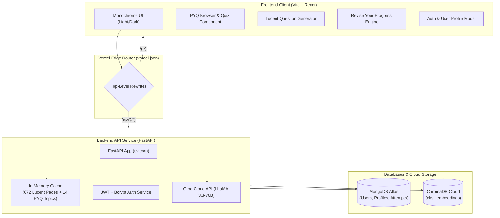

# SSC CHSL Intelligent Study Assistant & Question Generator

An AI-powered preparation platform tailored for competitive examinations (specifically SSC CHSL Tier-1), offering high-precision topic-wise Previous Year Questions (PYQs), dynamic question generation powered by Lucent GK OCR, automated answer validation, semantic vector retrieval via ChromaDB, performance analytics, and a progress revision engine.

Designed as a modern full-stack web application with a **React (Vite) Single-Page Application (SPA)** frontend and a **FastAPI** backend, fully configured for unified multi-service deployment on **Vercel**.

---

## 🚀 Key Features

### 1. Comprehensive SSC CHSL PYQ Question Bank
- **12,968+ Exam Questions Indexed**: Extracted from genuine SSC CHSL question papers (2019–2025).
- **Topic-Wise Categorization**: Pre-classified into standard General Awareness (GA) subject areas:
  - History (Ancient, Medieval, Modern India)
  - Geography (India & World)
  - Polity and Constitution of India
  - Economics and Banking Awareness
  - Science (Physics, Chemistry, Biology)
  - Current Affairs (National & International)
  - Awards and Honors
  - Sports and Games
  - Books and Authors
  - Important Days and Events
  - Environment and Ecology
  - Inventions and Discoveries
  - Cultural Heritage of India
  - Abbreviations and Terminology
- **Authentic Paper Metadata**: Every question displays its verified exam date (`dd-mm-yyyy`) parsed from official papers.
- **Smart Prioritization**: English-language questions are served first, sorted by repetition frequency with clear repetition badges (`Repeated 2x`, `Repeated 3x`).
- **Paginated Zero-Lag Delivery**: Pre-indexed in-memory caching ensures instant response times without heavy database overhead.

### 2. Lucent GK Page-by-Page Question Generator
- **672 OCR Pages**: Digitized pages from *Lucent General Knowledge in English*, complete with line-clustering, chapter headings, and topic tagging.
- **On-the-Fly Question Generation**: Converts any Lucent GK page into exam-grade multiple-choice questions (MCQs) complete with:
  - Question stem
  - Four distinct answer choices (A, B, C, D)
  - One strictly verified correct answer
  - Contextual explanation derived directly from the source page text.
- **Groq LLaMA-3.3-70B Integration**: Sub-second question synthesis from raw textbook excerpts.

### 3. Revise Your Progress (Interactive Revision Section)
- **Automatic Question Tracking**: Any question attempted by the user in the PYQ or Lucent tabs is automatically saved to the revision bank.
- **Filter Views**:
  - *All Attempted*
  - *Needs Revision (Incorrect)*
  - *Mastered (Correct)*
- **Reattempt Engine**: Candidates can re-test their weak questions, receive immediate correctness feedback, inspect their score recovery, and track the number of attempts.
- **MongoDB Persistence**: Stored under each candidate's profile in MongoDB Atlas.

### 4. Minimalist High-Contrast UI / UX
- **Monochrome Theme**: Sleek, distraction-free black-and-white aesthetic designed specifically for long study sessions.
- **Theme Switcher**: Instant light/dark mode toggle persisted in `localStorage`.
- **Responsive Layout**: Designed for mobile screens, tablets, and desktop displays.

### 5. Production Authentication & Security
- **JWT Authentication**: Secure user session tokens with 7-day expiration.
- **Bcrypt Password Hashing**: Salted passwords stored securely in MongoDB Atlas.
- **Dynamic CORS & IP Safeguards**: Cloud-tolerant JWT decoding designed for serverless microservices.

---

## 🏗️ System Architecture



---

## 📁 Repository Structure

```
question_genarator/
├── client/                               # Frontend Single Page Application
│   ├── dist/                             # Compiled production build
│   ├── public/                           # Static assets
│   ├── src/
│   │   ├── components/
│   │   │   ├── AuthModal.jsx             # User login and registration modal
│   │   │   ├── LucentQuestionGen.jsx     # Lucent page viewer & question generator
│   │   │   ├── Navbar.jsx                # Navigation, profile controls, theme toggle
│   │   │   ├── PYQSearch.jsx             # PYQ viewer with date badges & pagination
│   │   │   ├── ReviseProgress.jsx        # Dedicated attempted question & revision engine
│   │   │   ├── SectionsBanner.jsx        # Exam subject breakdown banner
│   │   │   └── UserProfileModal.jsx      # Candidate stats, accuracy & logout
│   │   ├── api.js                        # Unified Axios/Fetch API client with JWT interceptor
│   │   ├── App.jsx                       # Root view, state router & tab switcher
│   │   ├── index.css                     # Minimalist black & white stylesheet
│   │   └── main.jsx                      # Vite React entrypoint
│   ├── package.json                      # Frontend dependencies
│   └── vite.config.js                    # Vite configuration with local /api proxy
│
├── server/                               # Backend Serverless / REST Microservice
│   ├── extracted_json/                   # Master PYQ dataset
│   │   └── all_extracted_questions.json  # 12,968+ extracted and categorized questions
│   ├── ocr_gk_extraction/                # Master Lucent GK OCR dataset
│   │   └── lucent_gk_extracted.json      # 672 digitized book pages
│   ├── connection.py                     # MongoDB Atlas client & database ingestion pipeline
│   ├── embedding.py                      # ChromaDB vector embedding & cloud indexer
│   ├── extractor.py                      # Offline PDF OCR & PyMuPDF extraction scripts
│   ├── topic_classifier.py               # Question classifier & GA subject mapper
│   ├── server.py                         # Production FastAPI application & routes
│   ├── topic.txt                         # SSC CHSL official GA taxonomy
│   ├── requirements.txt                  # Slim serverless runtime dependencies (<40 MB)
│   └── requirements-offline.txt          # Heavy ML dependencies (PyTorch, EasyOCR, PyMuPDF)
│
├── vercel.json                           # Vercel multi-service routing configuration
├── .gitignore                            # Git exclusion rules
└── README.md                             # Project documentation
```

---

## 🛠️ Tech Stack

| Layer | Technologies |
|---|---|
| **Frontend** | React 18, Vite 5, Lucide React, Modern CSS Variables (Black & White Theme) |
| **Backend** | Python 3.11+, FastAPI, Uvicorn, Pydantic v2 |
| **Authentication** | PyJWT (HS256), Bcrypt (12 rounds) |
| **Databases** | MongoDB Atlas (`chsl_gnr`, `user_management`), ChromaDB Cloud (`chsl_embeddings`) |
| **AI / LLM** | Groq Cloud API (`llama-3.3-70b-versatile`) |
| **Offline Pipeline** | EasyOCR, PyTorch, PyMuPDF (`fitz`), NumPy |
| **Deployment** | Vercel Multi-Service Architecture (`services` config with SPA rewrite) |

---

## ⚙️ Environment Variables

Create a `.env` file in the project root or configure these in your deployment platform:

```env
# MongoDB Atlas
MONGO_URI=mongodb+srv://<username>:<password>@cluster0.mongodb.net/?retryWrites=true&w=majority
MONGODB_DB=chsl_gnr

# JWT Security
JWT_SECRET=your_super_secret_jwt_key_here
STRICT_IP_CHECK=false

# Groq Cloud API (for Lucent question generation)
GROQ_API_KEY=gsk_your_groq_api_key_here

# ChromaDB Cloud
USE_CHROMA_CLOUD=true
CHROMADB_API_KEY=ck-your_chroma_api_key_here
CHROMADB_TENANT=2d8eb3d4-29d6-4479-8c3b-3efc4ccd659c
CHROMADB_DATABASE=chsl_embeddings

# Frontend (Optional - defaults to relative /api)
VITE_API_URL=/api
```

---

## 💻 Local Development Setup

### Prerequisites
- Node.js (v18.0.0 or higher)
- Python 3.10 to 3.12
- MongoDB Atlas cluster URL

### 1. Clone the Repository
```bash
git clone https://github.com/Sanskar296/ssc_question_genrator.git
cd ssc_question_genrator
```

### 2. Configure Environment
Create a `.env` file in the root directory and populate your credentials as described in [Environment Variables](#️-environment-variables).

### 3. Setup and Run the Backend Server
```bash
# Navigate to server directory
cd server

# Create and activate a Python virtual environment
python -m venv venv
# On Windows:
.\venv\Scripts\activate
# On Linux/macOS:
source venv/bin/activate

# Install runtime dependencies
pip install -r requirements.txt

# Start FastAPI server on port 8000
python server.py
# Or using uvicorn:
uvicorn server:app --host 127.0.0.1 --port 8000 --reload
```
The server will start at `http://127.0.0.1:8000` and automatically cache Lucent GK pages and PYQ topics.

### 4. Setup and Run the Frontend Client
In a separate terminal window:
```bash
# Navigate to client directory
cd client

# Install Node dependencies
npm install

# Start Vite development server
npm run dev
```
Open your browser at `http://localhost:5173`. Vite automatically proxies `/api` calls to `http://127.0.0.1:8000`.

---

## 🌐 Deployment on Vercel

The repository is configured for **Vercel Multi-Services**, allowing both the Vite frontend and FastAPI backend to deploy from the same Git repository under a unified domain.

### Root `vercel.json` Specification:
```json
{
  "$schema": "https://openapi.vercel.sh/vercel.json",
  "services": {
    "client": {
      "root": "client",
      "framework": "vite"
    },
    "server": {
      "root": "server",
      "framework": "fastapi"
    }
  },
  "rewrites": [
    {
      "source": "/api/(.*)",
      "destination": {
        "service": "server"
      }
    },
    {
      "source": "/(.*)",
      "destination": {
        "service": "client"
      }
    }
  ]
}
```

### Steps to Deploy:
1. Push your code to your GitHub repository.
2. Go to [Vercel Dashboard](https://vercel.com) &rarr; **Add New Project**.
3. Import `Sanskar296/ssc_question_genrator`.
4. Add your environment variables (`MONGO_URI`, `JWT_SECRET`, `GROQ_API_KEY`, `CHROMADB_API_KEY`, etc.) in the Vercel project settings.
5. Click **Deploy**. Vercel will build both services independently and configure the edge routing.

---

## 📡 Core API Reference

### Authentication
- `POST /api/auth/register` &mdash; Create a new student account (Username, Password, Confirm Password).
- `POST /api/auth/login` &mdash; Authenticate user and issue a 7-day JWT token.
- `GET /api/auth/me` &mdash; Get active user profile and cumulative performance stats.

### Exam Sections & Questions
- `GET /api/sections` &mdash; Retrieve breakdown of the 4 SSC CHSL sections with active General Awareness focus.
- `GET /api/pyqs/search?topic={topic}&page={page}&limit={limit}` &mdash; Fetch clean, date-labeled General Awareness questions sorted with English and repeated questions prioritized.

### Lucent GK & Question Generation
- `GET /api/lucent/page/{page_number}` &mdash; Retrieve raw text and headings for a specific Lucent page (1 to 672).
- `POST /api/lucent/generate-questions` &mdash; Synthesize new MCQs from textbook content using Groq LLaMA-3.3.

### Revision & Progress Tracking
- `POST /api/user/record-attempt` &mdash; Record an answer attempt; updates accuracy and stores the question for revision.
- `GET /api/user/attempted-questions?filter_status={all|incorrect|correct}` &mdash; Retrieve questions for reattempt.
- `DELETE /api/user/attempted-questions/{question_id}` &mdash; Remove a question from the revision backlog.

---

## 🤝 Contributing & License
Contributions, feedback, and issue reports are welcome! Please open an issue or submit a pull request on the [GitHub Repository](https://github.com/Sanskar296/ssc_question_genrator).

Developed for competitive exam aspirants with ❤️.
